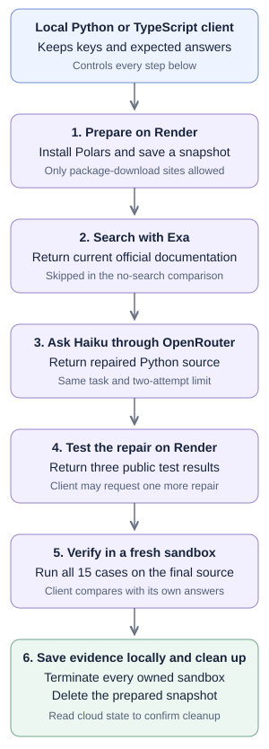

# Repair code with Exa and Render Sandboxes

<a href="../README.md" target="_blank" rel="noopener noreferrer">Back to the repository overview</a>

When a library changes, an AI model may suggest code that uses an older version. You need current documentation to inform the repair and a place to run the proposed code. A **sandbox** is a separate environment where you can execute code and inspect its results. In this guide, Render provides temporary Linux computers for that work, separate from your own computer.

This example combines **Exa documentation search**, **Claude Haiku through OpenRouter**, and **Render Sandboxes for code execution**. You finish with repaired Python files, their test results, and the documentation retrieved for the model.

Both the Python and TypeScript clients repair the same Python reporting module after a Polars upgrade. Polars is a library for working with tables. The module must put unequal-length columns side by side, turn category numbers into labels, and read calendar dates. For example, three days and two counts should produce three rows, with the last count left empty.

Each client, the program you run on your computer, compares two modes: the same model receives the task either without search or with documentation retrieved by Exa. Each mode gets at most two repair attempts. The final source faces 15 checks, including 12 inputs the model did not see, in a fresh sandbox. These are called **held-out tests**. The expected answers stay in the client.

Render Sandboxes is in early access. The comparison covers one repair task; both versions passed in the recorded run.

## How search and code execution work together

| Part | Where it runs | Its job |
| --- | --- | --- |
| Python or TypeScript client | Your computer | Coordinate the comparison, check results, save files, and clean up |
| Exa | Exa's service | Find and retrieve the relevant Polars documentation |
| Claude Haiku, reached through OpenRouter | Model provider's service | Propose a Python repair using the task, test feedback, and any retrieved documentation |
| Render Sandboxes | Render | Run the generated Python and test each final repair in a fresh environment |



You can also run the client on your own server. All three service keys stay with it. It sends only synthetic source, public test errors, and retrieved documentation to OpenRouter. A **snapshot** saves the prepared filesystem so each sandbox can start with the same installed Polars version. The snapshot is created before any repair code is uploaded.

## Prerequisites

- A <a href="https://render.com/docs/sandboxes" target="_blank" rel="noopener noreferrer">Render workspace with Sandboxes enabled</a>. The example uses the paid `starter` plan with a ten-minute lifetime per sandbox.
- An <a href="https://dashboard.exa.ai/api-keys" target="_blank" rel="noopener noreferrer">Exa API key</a> with search access and available credit.
- An <a href="https://openrouter.ai/settings/keys" target="_blank" rel="noopener noreferrer">OpenRouter key</a> with available model credit. The selected model is `anthropic/claude-haiku-5.5`.
- Python 3.11 or later for the Python client, or Node.js 22 or later for TypeScript.

| Setting | Purpose and access | Used by |
| --- | --- | --- |
| `RENDER_API_KEY` | <a href="https://render.com/docs/api#1-create-an-api-key" target="_blank" rel="noopener noreferrer">Render user key</a> that can create, inspect, execute in, snapshot and terminate sandboxes in the selected workspace | Local client only |
| `RENDER_WORKSPACE_ID` | The workspace's `tea-...` ID, selecting where resources are created; it is not a secret | Local client only |
| `EXA_API_KEY` | Authenticates documentation searches | Local client only |
| `OPENROUTER_API_KEY` | Authenticates model requests and account-credit checks | Local client only |

Both Render packages are pinned to version 1.2.0. This example uses the public Render HTTP interface for the initial domain allow-list because the pinned packages do not express those destination rules consistently. Later operations use the official packages. Execution sandboxes deny outbound networking.

## Set up the example

Clone this repository, which downloads the source to a new folder, then enter it:

```sh
git clone https://github.com/ojusave/exa-render-sandboxes.git
cd exa-render-sandboxes
```

All commands below run from this repository's root folder.

Choose a client. Both clients run the entire comparison independently; running both makes two sets of requests and resources.

<details open>
<summary><strong>Python</strong></summary>

Create a separate package directory, called a virtual environment, and install the required libraries:

```sh
python3 -m venv python/.venv
python/.venv/bin/python -m pip install -r python/requirements.txt
```

The Python implementation is <a href="../python/main.py" target="_blank" rel="noopener noreferrer">`python/main.py`</a>. Installation succeeds when pip completes without an error.

</details>

<details>
<summary><strong>TypeScript</strong></summary>

Install the versions recorded in the lockfile:

```sh
npm ci --prefix typescript
```

The TypeScript implementation is <a href="../typescript/main.ts" target="_blank" rel="noopener noreferrer">`typescript/main.ts`</a>. Installation finishes when npm exits without an error.

</details>

Configure the four settings above in your existing environment, or copy the placeholder file:

```sh
cp .env.example .env
chmod 600 .env
```

Open `.env` in your editor and replace each placeholder with your own value. The file keeps credentials between runs; Git ignores it, and `chmod 600` restricts reading and writing to your operating-system user. Keep the Render key and workspace ID in the same account. These commands print nothing when successful.

Load the file you just edited into this terminal. `set -a` makes its settings available to child programs, and `set +a` restores the usual behavior:

```sh
set -a
. ./.env
set +a
```

## Run the comparison

From the repository root, choose either client:

<details open>
<summary><strong>Python</strong></summary>

```sh
python/.venv/bin/python python/main.py compare \
  --repetitions 1 --run-dir .runs/my-python-comparison
```

</details>

<details>
<summary><strong>TypeScript</strong></summary>

```sh
typescript/node_modules/.bin/tsx typescript/main.ts compare \
  --repetitions 1 --run-dir .runs/my-typescript-comparison
```

</details>

Choose a new run-directory name each time. The runner refuses to overwrite prior evidence.

The runner checks model credit and supported settings before allocating a sandbox. It then installs Polars 2.0.0, validates the original failures and maintainer solution, runs both model modes, and cleans up. `running` means the machine is ready; it does not mean the repair passed. A one-pair comparison creates five temporary sandboxes and one snapshot, makes one Exa search, and makes at most four model requests.

The initial `Run journal:` line identifies the saved record. While cloud commands run, output can be quiet for several minutes. After each mode, the runner prints the number of passed checks and elapsed time. Final cleanup confirmation is separate from repair success.

## Read and verify the result

Open `run.json` inside the printed run directory. Each trial records the final source, source fingerprint, public feedback, all 15 verification results, model usage, elapsed time and Exa search evidence. A **fingerprint**, also called a SHA-256 hash, identifies the exact file bytes. The source files are also saved beside the journal.

The model's success claim does not determine the result. The host compares returned values, order, missing values, types and expected errors with <a href="../shared/cases.json" target="_blank" rel="noopener noreferrer">the fixed test cases</a>. It never sends the held-out inputs or <a href="../shared/reference.py" target="_blank" rel="noopener noreferrer">maintainer reference solution</a> to the model. The reference solution checks the test setup, and is overwritten before the first repair begins.

Model and Exa charges are recorded when their responses report them. Render compute and snapshot charges are separate and are not estimated by this runner. Timing includes repair, search and final verification, but excludes package setup, calibration and initial repair-machine creation.

## Cleanup and recovery

Cleanup terminates every machine owned by the run and deletes its prepared snapshot. These operations destroy remote scratch files. The journal and submitted source are already saved locally and remain available. Cleanup runs after success, an exception, or a normal interrupt, and reads the cloud state to verify the result.

If the process was forcibly killed or cleanup was not confirmed, rerun cleanup against that exact run directory:

<details open>
<summary><strong>Python</strong></summary>

```sh
python/.venv/bin/python python/main.py cleanup \
  --run-dir .runs/my-python-comparison
```

</details>

<details>
<summary><strong>TypeScript</strong></summary>

```sh
typescript/node_modules/.bin/tsx typescript/main.ts cleanup \
  --run-dir .runs/my-typescript-comparison
```

</details>

A lost creation response can leave an unknown resource ID. The runner keeps that uncertainty visible instead of claiming cleanup succeeded or blindly creating another resource. Check the Render workspace near the recorded creation time before proceeding. Sandboxes also have a ten-minute lifetime and snapshots a one-hour expiry.

When finished, remove credentials from the terminal with the command below. If you created `.env` only for this run, also delete that file after confirming cleanup. This removes local credentials, not your provider account or remote resources.

```sh
unset RENDER_API_KEY RENDER_WORKSPACE_ID EXA_API_KEY OPENROUTER_API_KEY OPENROUTER_MODEL
rm .env
```

## Related examples

For different workflows, see <a href="https://github.com/ojusave/render-workflows-exa-langchain" target="_blank" rel="noopener noreferrer">Exa research with Render Workflows</a> and <a href="https://github.com/ojusave/openrouter-sandboxes" target="_blank" rel="noopener noreferrer">OpenRouter tool calling with Render Sandboxes</a>.
